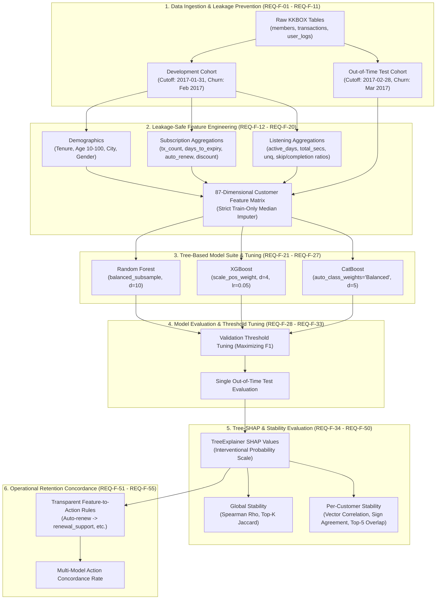

# SHAP Explanation Stability Evaluation System for KKBOX Churn Prediction

**Authors:** Bhumi Wadhwani & Ayushi Ralhan  
**Guidance:** Prof. Ajaj Khan  
**Department:** Computer Science & Engineering, Medi-Caps University, Indore  
**Academic Year:** B.Tech Major Project (VII Semester), 2026  

---

## 1. Executive Summary

This project implements the **SHAP Explanation Stability Evaluation System** for music-streaming customer churn prediction using real data from the **Kaggle WSDM KKBOX Churn Prediction Challenge**. 

While explainable AI (XAI) techniques such as SHAP (SHapley Additive exPlanations) are widely used to interpret churn prediction models, explanations can vary across different algorithms even when models exhibit comparable prediction accuracy. This pipeline systematically investigates:
1. **Model Performance**: Training **Random Forest**, **XGBoost**, and **CatBoost** classifiers separately with documented hyperparameter searches to maximize out-of-time accuracy.
2. **Leakage-Safe Feature Engineering**: Building customer-level feature representations strictly before prediction cutoff dates ($T_{\text{early}} = \text{2017-01-31}$ and $T_{\text{late}} = \text{2017-02-28}$) across transactions, listening logs, and demographic records.
3. **Global & Local Explanation Consistency**: Measuring explanation stability across models using **Jaccard similarity** of top-$K$ features ($K \in \{5, 10, 15\}$), **Spearman rank correlation** of feature importance, and per-customer SHAP vector correlations and sign agreements across representative customer subgroups (TP, FP, TN, FN, model agreement, and model disagreement).
4. **Actionable Retention Concordance**: Mapping top positive churn drivers to rule-based retention actions (`renewal_support`, `plan_or_price_communication`, `engagement_campaign`, `general_review`) to verify whether explanation stability translates into stable business decisions.

> **Research Prototype Note (REQ-F-42, REQ-F-60):** Prediction performance is evaluated to confirm that models function as viable churn predictors. SHAP explains the internal associative behavior of trained models and does not prove causal mechanisms of customer churn. Every reported figure is produced directly by executing the pipeline.

---

## 2. System Architecture & Methodology



---

## 3. Experimental Results Summary

### 3.1 Model Prediction Performance (Out-of-Time Test Set)

| Model | Evaluated Split | Accuracy | Precision | Recall | F1-Score | ROC-AUC | PR-AUC | Log Loss | Tuned Threshold |
| :--- | :--- | :---: | :---: | :---: | :---: | :---: | :---: | :---: | :---: |
| **XGBoost** | Out-of-Time Test | **89.96%** | **0.4267** | 0.3787 | 0.4012 | **0.7984** | **0.3587** | 0.4481 | 0.77 |
| **CatBoost** | Out-of-Time Test | **89.86%** | 0.4195 | 0.3670 | 0.3915 | **0.7974** | 0.3586 | 0.4656 | 0.78 |
| **Random Forest** | Out-of-Time Test | **87.38%** | 0.3546 | **0.5128** | **0.4193** | 0.7784 | 0.3217 | **0.4334** | 0.56 |

*Three-model prediction consensus rate: **93.58%** of customers received unanimous predictions across all three models.*

---

### 3.2 Global Explanation Stability Measures

| Comparison Pair | Spearman Rank Correlation ($\rho$) | Top-5 Jaccard Similarity | Top-5 Feature Overlap | Top-10 Jaccard Similarity | Top-10 Feature Overlap | Top-15 Jaccard Similarity | Top-15 Feature Overlap |
| :--- | :---: | :---: | :---: | :---: | :---: | :---: | :---: |
| **XGBoost vs CatBoost** | **0.9601** | **1.0000** | **5 / 5** | **0.5385** | **7 / 10** | **0.7647** | **13 / 15** |
| **RandomForest vs CatBoost** | **0.9327** | 0.4286 | 3 / 5 | 0.3333 | 5 / 10 | 0.5789 | 11 / 15 |
| **RandomForest vs XGBoost** | **0.9282** | 0.4286 | 3 / 5 | 0.3333 | 5 / 10 | 0.4286 | 9 / 15 |

---

### 3.3 Per-Customer Stability Across Stratified Subgroups (n=100)

| Subgroup | Sample Size | RF vs XGB Vector Corr | RF vs XGB Sign Agree | RF vs CAT Vector Corr | RF vs CAT Sign Agree | XGB vs CAT Vector Corr | XGB vs CAT Sign Agree |
| :--- | :---: | :---: | :---: | :---: | :---: | :---: | :---: |
| **Overall Cohort** | 100 | 0.7913 | 83.53% | 0.8099 | 81.35% | **0.9417** | **83.56%** |
| **Full Model Agreement** | 80 | 0.7752 | 82.90% | 0.7885 | 80.99% | **0.9345** | **83.15%** |
| **Model Disagreement** | 20 | 0.8559 | 86.04% | 0.8955 | 82.76% | **0.9704** | **85.23%** |
| **Actual Churners** | 45 | 0.7981 | 84.60% | 0.8239 | 81.25% | **0.9375** | **84.22%** |
| **Actual Non-Churners**| 55 | 0.7858 | 82.66% | 0.7985 | 81.42% | **0.9450** | **83.03%** |

---

### 3.4 Top Churn Drivers Identified Across Models (SHAP)

1. `last_is_auto_renew` (Dominant negative churn driver: auto-renewal drastically prevents churn)
2. `payment_method_id` (Payment channel stability / friction)
3. `registered_via` (Acquisition cohort channel)
4. `tx_days_since_last` (Days elapsed since latest subscription transaction)
5. `tx_auto_renew_rate` (Longitudinal consistency of auto-renewal)
6. `tx_days_until_expiry` (Proximity of membership expiration to cutoff date)
7. `last_actual_amount_paid` (Current billing amount paid)
8. `tx_total_paid` (Cumulative customer lifetime spend)
9. `log_skip_ratio` (Ratio of songs skipped before 25% duration)
10. `log_days_since_last` (Recency of music playback activity)
11. `log_completion_ratio` (Ratio of songs completed to 100%)
12. `tenure_days` (Days since initial service registration)

---

### 3.5 Rule-Based Retention Recommendation Concordance

- **Three-Model Full Concordance**: **74.0%** of customers received the exact same operational retention action recommendation regardless of whether Random Forest, XGBoost, or CatBoost was the underlying model.
- **Pairwise Action Concordance**:
  - XGBoost vs CatBoost: **94.0%**
  - Random Forest vs XGBoost: **76.0%**
  - Random Forest vs CatBoost: **76.0%**
- **Action Breakdown**:
  - `renewal_support`: 55% - 57% (targeted expiration notices, auto-renew opt-in incentives)
  - `plan_or_price_communication`: 27% - 38% (pricing tier adjustment, flexible installment billing)
  - `general_review`: 14% - 18% (loyalty outreach, customer satisfaction survey)
  - `engagement_campaign`: 1% - 8% (personalized playlists, artist release push notifications)

---

## 4. Repository Structure

```
shap_churn_stability/
├── data/
│   ├── raw/                       # Raw KKBOX CSV files and compressed archives
│   └── processed/                 # Processed customer feature splits
├── src/
│   ├── __init__.py                # Package initialization
│   ├── config.py                  # Cutoff dates, random seeds, hyperparameters, action rules
│   ├── data_loader.py             # Chunked & streaming readers, data inspection report (REQ-F-01-08)
│   ├── feature_engineering.py     # Leakage-safe aggregation, age cleaning, imputation (REQ-F-09-20)
│   ├── models.py                  # RF, XGBoost, CatBoost builders & hyperparameter tuning (REQ-F-21-27)
│   ├── evaluation.py              # Performance metrics & validation threshold optimization (REQ-F-28-33)
│   ├── shap_explainer.py          # TreeExplainer, global importances & 100-user cohort (REQ-F-34-42)
│   ├── stability.py               # Jaccard, Spearman rho, per-customer vector correlation (REQ-F-43-50)
│   ├── retention_rules.py         # Transparent feature-to-action mapping & concordance (REQ-F-51-55)
│   └── visualization.py           # Publication-quality ROC, SHAP, and heatmap generator (REQ-F-56-58)
├── results/                       # Trained joblib models, metrics CSVs, JSON audits, PNG plots
├── notebooks/
│   └── 01_shap_stability_evaluation.ipynb # Interactive exploration notebook
├── backend/
│   └── app.py                     # FastAPI REST API serving model explanations & status
├── frontend/
│   └── index.html                 # "Churn Pulse" dashboard (reads /api/dashboard; offline snapshot fallback)
├── run_pipeline.py                # End-to-end command-line orchestrator
└── README.md                      # Complete system documentation
```

---

## 5. Getting Started & Execution

### 5.1 Prerequisites & Installation

Activate your Python environment and verify installed dependencies:
```bash
python --version  # Python 3.11, 3.12, or 3.13 supported
pip install xgboost catboost shap scikit-learn pandas numpy matplotlib seaborn fastapi uvicorn
```

### 5.2 Running the End-to-End Research Pipeline

Execute the full 13-stage pipeline from the project root:
```bash
python run_pipeline.py --data-dir data/raw --output-dir results --max-users 25000 --max-tx-rows 5000000 --max-log-rows 8000000 --shap-sample-size 100 --background-size 100 --seed 42
```

### 5.3 Launching the Interactive Web Dashboard

To launch the interactive dashboard providing visual comparisons and live REST endpoints:
```bash
uvicorn backend.app:app --host 127.0.0.1 --port 8000 --reload
```
Then navigate to: `http://127.0.0.1:8000`

### 5.4 Running the Jupyter Notebook

Open and run the research walkthrough notebook:
```bash
jupyter notebook notebooks/01_shap_stability_evaluation.ipynb
```

---

## 6. Medi-Caps University SRS Compliance Matrix

| SRS Requirement | Description | Status in Pipeline | Implementation Reference |
| :--- | :--- | :---: | :--- |
| **REQ-F-01 - 08** | Raw data ingestion, chunked processing, inspection report, read-only raw files | **Completed** | `src/data_loader.py` |
| **REQ-F-09 - 11** | Strict cutoff enforcement, lookback window, automated date leakage check | **Completed** | `src/feature_engineering.py` |
| **REQ-F-12 - 15** | Customer aggregation, implausible age filtering (10-100), demographic/tx/log features | **Completed** | `src/feature_engineering.py` |
| **REQ-F-16 - 20** | Equivalent feature representations, train-only imputation, stratified splits | **Completed** | `src/feature_engineering.py` |
| **REQ-F-21 - 27** | RF, XGBoost, CatBoost classifiers, class weighting, small documented tuning, seed 42 | **Completed** | `src/models.py` |
| **REQ-F-28 - 33** | Accuracy, Precision, Recall, F1, ROC-AUC, PR-AUC, threshold tuning, test isolation | **Completed** | `src/evaluation.py` |
| **REQ-F-34 - 42** | TreeExplainer, mean \|SHAP\| ranking, 100-customer stratified cohort, additivity | **Completed** | `src/shap_explainer.py` |
| **REQ-F-43 - 50** | Jaccard Top-K (K=5,10,15), Spearman rho, per-customer vector correlation, sign agreement | **Completed** | `src/stability.py` |
| **REQ-F-51 - 55** | Transparent rule-based retention actions, justification logging, concordance analysis | **Completed** | `src/retention_rules.py` |
| **REQ-F-56 - 60** | Automated tabular exports, ROC/PR curves, SHAP comparison, heatmaps, reproducibility | **Completed** | `src/visualization.py`, `run_pipeline.py` |
